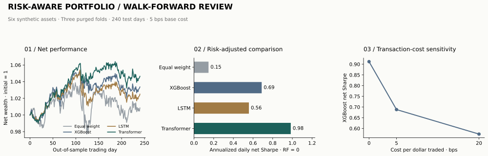

# Risk-Aware Portfolio Optimization with Deep Learning

A model can predict returns and still build a lousy portfolio. Trading costs, concentration, and tail losses have a way of eating the apparent edge.

I built this project to connect forecasting to the actual allocation decision. XGBoost, an LSTM, and a temporal Transformer estimate returns and volatility; a CVXPY optimizer turns those estimates into portfolios with explicit risk, turnover, and exposure limits.

[Results](results/RESULTS.md) · [Methodology](METHODS.md) · [Optimizer](src/optimize.py) · [Tests](tests/test_research.py) · [MLflow records](results/tracking_export.json)



## The short version

The recorded run trains all three models on a **seeded six-asset synthetic market**, then evaluates them across **three purged walk-forward folds**, **48 rebalances**, and **240 out-of-sample trading days**.

| Strategy | Net return | Annualized net Sharpe | Max drawdown |
| --- | ---: | ---: | ---: |
| Equal weight | 0.85% | 0.148 | -5.94% |
| XGBoost + CVaR | 3.37% | 0.688 | -3.01% |
| LSTM + CVaR | 2.50% | 0.558 | -4.10% |
| Transformer + CVaR | 4.65% | 0.984 | -2.99% |

All four pay 5 bps per dollar of total buys plus sells. These are results from this synthetic path, with a zero risk-free rate for Sharpe—not a live investment record.

Removing CVaR worsened XGBoost drawdown to **-5.62%** in the ablation. Increasing transaction costs from 0 to 20 bps reduced its net Sharpe from **0.912 to 0.574**. The costs aren't decorative; they change both the trades and the outcome.

## What’s implemented

- **Polars features:** trailing returns, momentum, volatility, and explicit asset identity.
- **Actual model training:** XGBoost regressors and small PyTorch LSTM/Transformer models with return and volatility outputs.
- **Purged evaluation:** training labels end before the test boundary; scaling uses training data only.
- **Constrained optimization:** 95% scenario CVaR, 35% single-asset cap, 65% group caps, and a 30% total-traded limit per rebalance.
- **Execution accounting:** drifted holdings, five-day holding periods, and transaction costs.
- **MLflow tracking:** parent/strategy runs, hyperparameters, metrics, artifacts, and a checked-in export.
- **Controls:** CVaR, turnover, and volatility ablations; cost sensitivity; hypothetical static stress shocks.

## Run it

The recorded environment uses Python 3.12 and CPU PyTorch. The first install downloads the CPU runtime; there is no GPU requirement.

```bash
python -m pip install -r requirements.txt
python -m src.run
python -m src.report
python -m unittest discover -s tests -v
```

`src.run` creates local MLflow records under `mlruns/` and refreshes the result files. `src.report` rebuilds the chart and readable report. No market-data API key is needed.

## Inspect the work

- [Results and ablations](results/RESULTS.md): comparison tables, forecast errors, costs, and stress outcomes.
- [Research design](METHODS.md): information timing, purge rules, optimization objective, and metric definitions.
- [Daily net returns](results/daily_returns.csv): the observations behind Sharpe and drawdown.
- [Forecasts](results/forecasts.csv): model outputs at every test rebalance.
- [Weight and solver traces](results/weights.json): allocations, trading, modeled CVaR, and fallback status.
- [Machine-readable metrics](results/metrics.json): fold boundaries, dataset hash, versions, and run IDs.
- [Test verification](results/verification.json): the recorded software checks.

The scope is deliberately compact: real training and optimization on synthetic data, with enough evidence to inspect the whole chain. Historical market validation, capacity modeling, and multi-seed inference would be separate studies.
