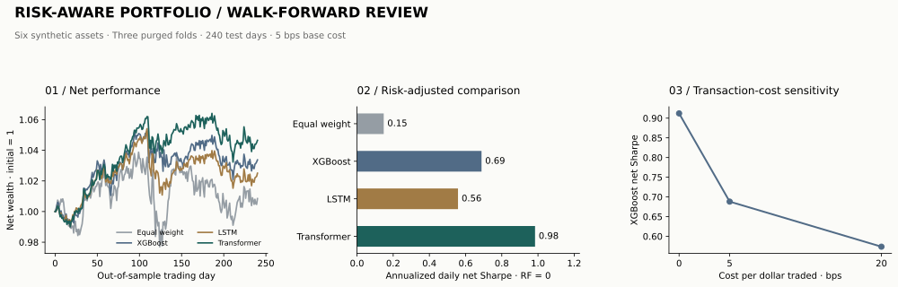

# Recorded study results

Actual model training and CVXPY solves on a seeded synthetic market. Figures describe this dataset and execution model, not a live investment track record.



| Strategy | Net return | Net Sharpe | Max drawdown | Mean L1 turnover | Fallbacks |
| --- | ---: | ---: | ---: | ---: | ---: |
| equal_weight | 0.85% | 0.148 | -5.94% | 1.06% | 0 |
| xgboost | 3.37% | 0.688 | -3.01% | 23.67% | 0 |
| lstm | 2.50% | 0.558 | -4.10% | 10.89% | 0 |
| transformer | 4.65% | 0.984 | -2.99% | 15.25% | 0 |
| xgboost_no_cvar | 2.47% | 0.315 | -5.62% | 25.90% | 0 |
| xgboost_no_turnover | 3.34% | 0.702 | -2.73% | 33.74% | 0 |
| xgboost_flat_vol | 2.90% | 0.436 | -6.11% | 24.63% | 0 |

## Findings

The Transformer has the highest net Sharpe in this single synthetic path. XGBoost and LSTM also exceed the equal-weight baseline here. This small comparison does not establish that one architecture is generally superior; no multi-seed significance claim is made.

Removing CVaR increases the XGBoost portfolio's realized drawdown in this run. Removing the turnover cap improves its Sharpe slightly while increasing trading. Flattening volatility estimates worsens drawdown. The constraints do not improve every metric simultaneously.

CVaR is a forecast-scenario loss constraint; realized maximum drawdown is a different path-dependent statistic. A low modeled CVaR is not a realized loss guarantee.

## Cost sensitivity

| Total-traded cost | XGBoost net Sharpe | Net return |
| --- | ---: | ---: |
| 0 bps | 0.912 | 4.59% |
| 5 bps | 0.688 | 3.37% |
| 20 bps | 0.574 | 2.80% |

These cases rerun both optimization and execution with frozen forecasts. They include the effect of changing cost penalties on target weights.

## Hypothetical static stress losses

| Strategy | Equity selloff | Inflation shock | Credit liquidity |
| --- | ---: | ---: | ---: |
| equal_weight | -5.42% | -5.83% | -5.17% |
| xgboost | -1.63% | -3.85% | -4.85% |
| lstm | -1.67% | -4.60% | -3.31% |
| transformer | -1.90% | -3.76% | -4.96% |

Shocks are applied to last rebalance target weights, without subsequent trading or recovery. This is a static exposure check; exact shock vectors are in src/run.py.

## Forecast errors

| Model | Mean 5-day return MAE | Mean 5-day volatility MAE |
| --- | ---: | ---: |
| xgboost | 0.01201 | 0.00657 |
| lstm | 0.01191 | 0.00867 |
| transformer | 0.01182 | 0.00812 |

MAEs use decimal five-day return units and equal averaging over equally sized folds. Better return MAE need not imply better portfolio outcomes.

## Reproduction and evidence

```bash
python -m src.run
python -m src.report
python -m unittest discover -s tests -v
```

Seed: `20261110`. Dataset SHA-256: `6ccf423c973bdac1fda6e3fc31200910598c75238fc1c69fb5aef231d1103309`. Model/solver versions and exact train-label boundaries are in [metrics.json](metrics.json).

Evidence: [daily returns](daily_returns.csv), [forecasts](forecasts.csv), [weight/solver traces](weights.json), [MLflow export](tracking_export.json), [verification](verification.json), and [methodology](../METHODS.md). MLflow's local file store is regenerated under mlruns/ and excluded from Git.
